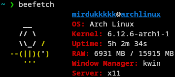

# 🐝fetch

   

> A 🐝 is _buzzing_

## Screenshot (🐝)



## One-line Compilation

Linux / macOS:

```bash
CGO_ENABLED=0 go build -trimpath -ldflags="-s -w" -o beefetch ./cmd/beefetch
```

Windows (PowerShell):

```powershell
$env:CGO_ENABLED=0
go build -trimpath -ldflags="-s -w" -o beefetch.exe ./cmd/beefetch
```

## 🐝's

[@mirdukkkkk](https://github.com/mirdukkkkk), [@EtherCD](https://github.com/EtherCD)
